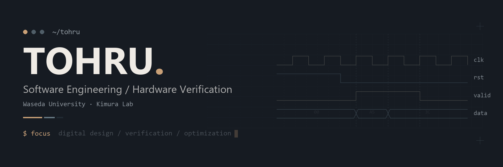

<picture>
  <source media="(prefers-reduced-motion: reduce) and (max-width: 600px)" srcset="./assets/hero-mobile.png">
  <source media="(prefers-reduced-motion: reduce)" srcset="./assets/hero.png">
  <source media="(max-width: 600px)" srcset="./assets/hero-mobile.gif">
  
</picture>

# Hi, I'm Tohru.

I'm pursuing a master's degree at **Waseda University**'s Graduate School of Information, Production and Systems, following my studies in Software Engineering at **Xiamen University**.

My work spans **Linux systems, backend engineering, and applied AI**, with a focus on building reliable software and evaluating it through meaningful testing and reproducible experiments. I'm also developing my foundation in **digital hardware design and verification** as I explore hardware-oriented research.

**Connect:** [Email](mailto:suyanyu.cs@gmail.com) · [University email](mailto:yanyu.su@toki.waseda.jp) · [LinkedIn](https://www.linkedin.com/in/tohru-watanabe) · [ORCID](https://orcid.org/0009-0002-5960-6106)

## Current focus

<picture>
  <source media="(prefers-reduced-motion: reduce)" srcset="./assets/prompt.svg">
  
</picture> <strong>Currently</strong>

I'm strengthening my foundations in **hardware design and verification** while continuing work on **Linux performance measurement, backend systems, and reproducible experimental evaluation**.

## Experience

- **Rakuten Group · Software Engineering Intern** — Developed search features and frontend interfaces for a furniture discovery application using Python/Flask and React/TypeScript.
- **ADK Holdings · Data Science Camp** — Analyzed consumer survey data with Python and developed a retail marketing strategy using STP, 3C, and 4P frameworks.
- **DENSO · Automotive SoC Intern** — Investigated system wake-up latency and performance issues using C and measurement tools.
- **TokiTech · Web Developer** — Developed business applications using Java/Spring Boot, Vue.js, and relational databases.
- **BitMeta Technology (China) · Frontend Development Intern** — Contributed to website frontend development and maintenance.

## Featured projects

My portfolio focuses on **systems programming, developer tooling, full-stack engineering, and reproducible algorithm experiments**, with additional work in computer vision, robotics simulation, and data analysis.

### [Linux Wake-up Latency Benchmark](https://github.com/TohruSu/linux-wakeup-latency-benchmark)

*C11 · Linux/POSIX · Python · GitHub Actions*

A Linux toolkit for measuring application-observed wake-up lateness and analyzing the resulting CSV data.

- **Core implementation:** Absolute monotonic scheduling, checked timestamp arithmetic, and skipped-period accounting.
- **My work:** C collector and Python analysis pipeline with strict CSV validation, descriptive statistics, and visualizations.
- **Verification:** C/Python tests, ASan/UBSan, and GCC/Clang GitHub Actions.

### [RepoPort — Git Filename Portability Checker](https://github.com/TohruSu/RepoPort)

*Python 3.11+ · Git · Unicode · GitHub Actions*

A small, read-only CLI that flags potentially non-portable Git-tracked paths, including case/Unicode collisions and Windows-incompatible names.

- **Core implementation:** NUL-delimited Git index scanning, Unicode case/NFC checks, Windows filename rules, deterministic diagnostics, and CI-friendly exit codes.
- **My work:** MVP scoping and acceptance criteria, implementation review, regression testing, and release validation.
- **Verification:** 19 automated tests, Ubuntu/Windows CI with Python 3.11/3.14.

### [PyPathDoctor — Windows Python Command Diagnostics](https://github.com/TohruSu/PyPathDoctor)

*PowerShell 5.1 / 7 · Windows · GitHub Actions*

A lightweight PowerShell CLI that shows which Python-related commands your Windows terminal finds and how PATH affects their resolution.

- **Core implementation:** PowerShell command discovery, PATH precedence reporting, virtual-environment and WindowsApps checks, and practical diagnostic suggestions.
- **My work:** MVP scoping, diagnostic review, targeted regression fixes, and release verification.
- **Verification:** 29 automated tests, passing Windows PowerShell 5.1 / PowerShell 7 CI, and checks against a multi-installation Python environment.

### [PathReplay — 2D Trajectory CSV Viewer](https://github.com/TohruSu/PathReplay)

*React · TypeScript · Vite · SVG · Vitest · GitHub Actions*

A browser-based tool for comparing and replaying 2D trajectories from local CSV files. [Try the live demo](https://tohrusu.github.io/PathReplay/).

- **Core implementation:** Local CSV validation and grouping, equal-scale SVG plotting, timestamp-based interpolation, and interactive replay for one or two trajectories.
- **My work:** MVP scoping and acceptance criteria, implementation review, regression verification, and browser-based release acceptance.
- **Verification:** 52 automated tests, successful CI and GitHub Pages deployment, and import of 14,342 synthetic simulator samples across 28 trajectory runs.

### [CuePair — Subtitle Timeline Comparator](https://github.com/TohruSu/CuePair)

*React · TypeScript · Vite · Vitest · GitHub Actions*

A browser-based tool for comparing original and translated subtitle tracks by timing, even when their cue counts or segmentation differ. [Try the live demo](https://tohrusu.github.io/CuePair/).

- **Core implementation:** UTF-8 SRT parsing, sweep-line and union-find temporal grouping, unmatched cue and timing-overlap detection, and interactive timeline navigation.
- **My work:** MVP scoping, implementation review, randomized correctness verification, browser testing, and release validation.
- **Verification:** 45 automated tests, independent randomized grouping checks, passing CI, and GitHub Pages deployment. [v0.1.0 release](https://github.com/TohruSu/CuePair/releases/tag/v0.1.0).

### [RoomShelf — Furniture Catalog Explorer](https://github.com/TohruSu/roomshelf-catalog-explorer)

*React 19 · TypeScript · Flask · SQLite · Playwright*

A full-stack furniture catalog for exploring products, comparing specifications, and saving favorites without an account.

- **Core implementation:** URL-driven catalog queries, product comparison, transactional SQLite shortlists, and signed sessions with CSRF/Origin checks.
- **My work:** Project scoping, technical design, feature development and review, testing, and documentation.
- **Verification:** 393 backend tests, 223 frontend tests, 40 Chromium browser tests, and GitHub Actions.

### [AdaptiveQueue — RL Job Scheduling](https://github.com/TohruSu/adaptivequeue)

*Python · Tabular Q-Learning · Scheduling Algorithms · pytest · GitHub Actions*

A scheduling simulator that explores when learned policy selection can improve on fixed rules under changing job workloads.

- **Core implementation:** Discrete-time task simulation, four deterministic scheduling baselines, and a tabular Q-Learning meta-scheduler.
- **My work:** Scheduling and reward design, implementation review, and reproducible benchmark analysis.
- **Verification:** 81 automated tests, Python 3.10/3.12 CI, and 720 seeded evaluation records across three workload scenarios.

### [Jetson Multimodal Emergency Detection](https://github.com/TohruSu/jetson-multimodal-emergency-detection)

*Python · Jetson Nano · Depth Anything V2 · Multiprocessing · PyQt5*

A university team prototype combining pose-based fall detection, speech help keywords, and relative depth for contextual alerts.

- **Core implementation:** Sensor and inference workers, event-fusion logic, and a PyQt5 monitoring interface.
- **My work:** Depth Anything V2 integration, person ROI processing, and pose-to-depth handoff.
- **Verification:** 132 automated tests, a synthetic five-worker smoke test, and GitHub Actions.

### [Autonomous Tractor Navigation Simulation](https://github.com/TohruSu/autonomous-tractor-navigation-sim)

*C# · .NET 10 · Stanley / Pure Pursuit · GitHub Actions*

A standalone toolkit for reproducible path tracking and controller evaluation on synthetic routes.

- **Core implementation:** Stanley and Pure Pursuit controllers, deterministic bicycle-model simulation, and steering constraints.
- **My work:** Seven synthetic scenarios, CSV evaluation metrics, and trajectory comparisons across four controller configurations.
- **Verification:** 61 automated tests, repeatable CSV/SVG outputs, and GitHub Actions.

### [Retail Customer Segmentation & Strategy](https://github.com/TohruSu/retail-customer-segmentation)

*Python · pandas · scikit-learn · PCA / KMeans · GitHub Actions*

From exploring shopping behavior to designing 「今日の食えらび編集室」, a meal-choice experience for food retail.

- **Core implementation:** Synthetic data generation, preprocessing, PCA/KMeans diagnostics, and an eight-stage analysis workflow.
- **My work:** Customer analysis, interpretation, and the original meal-choice retail strategy concept.
- **Verification:** 72 automated tests, eight executable notebooks, reproducible outputs, and Python 3.11–3.13 CI.

## Tools I use

###  Languages

**Most often:** Python · Java · JavaScript / TypeScript  
**Also:** C / C++ · C#

###  Web development

Spring Boot · Flask · React · Vue.js  
MySQL · SQLite

###  Systems and tooling

Linux/POSIX · PowerShell · Git · GitHub Actions  
Performance measurement · Automated testing · Sanitizers

###  Other interests

Computer vision · Depth estimation · Multimodal sensing  
Reinforcement learning · Path-tracking simulation

## Outside of code

I play the piano, enjoy badminton, and occasionally lose track of time editing music videos. I'm fond of Haruki Murakami's novels and the films of Christopher Nolan and Quentin Tarantino.

Thanks for stopping by! If anything catches your interest, feel free to explore my projects.
