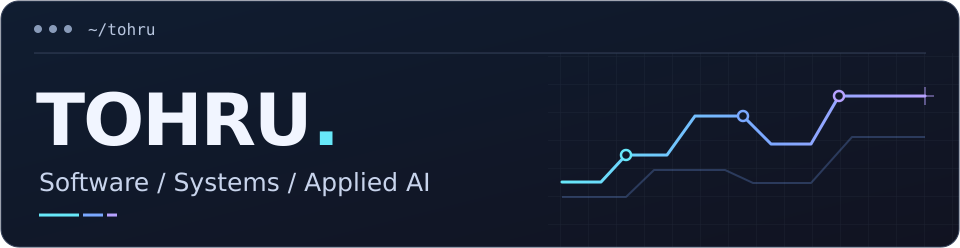
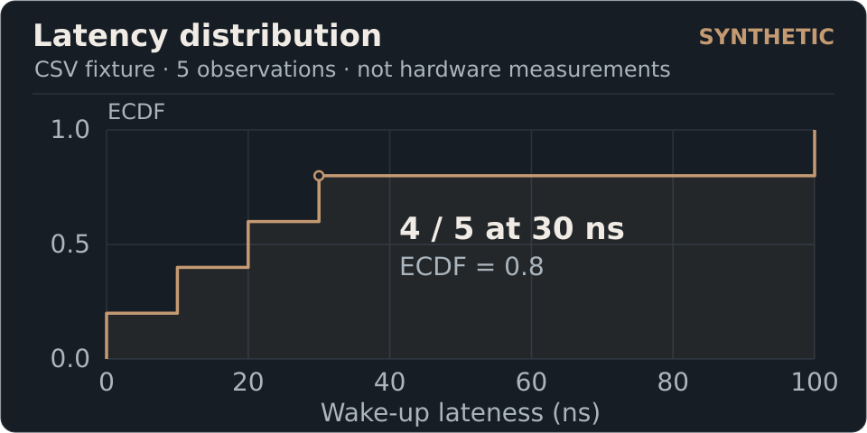
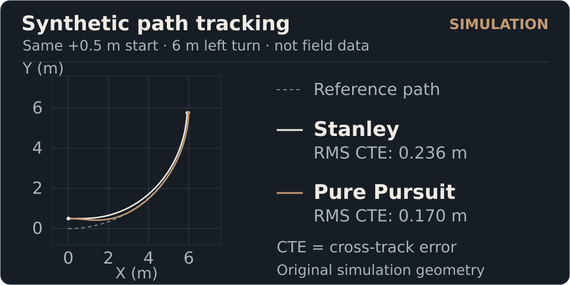
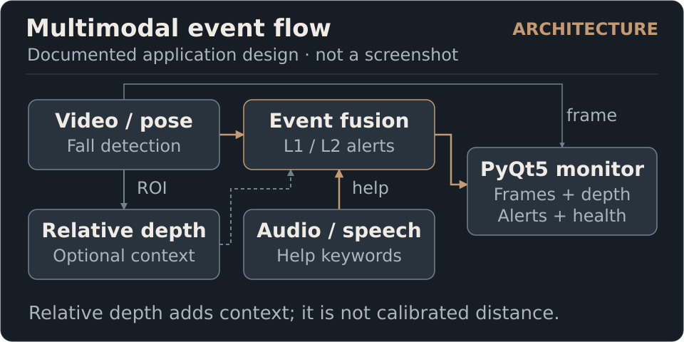
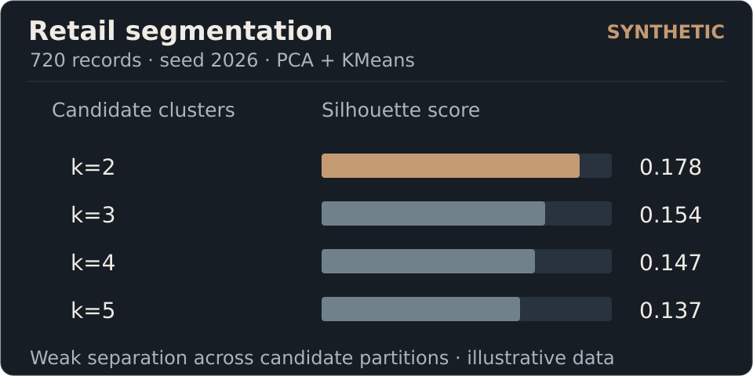

<picture>
  <source media="(max-width: 600px)" srcset="./assets/hero-mobile.svg">
  
</picture>

# Hi, I'm Tohru.

I'm studying for a master's in **Information, Production and Systems at Waseda University**, and expect to graduate in March 2028. Before that, I studied Software Engineering at **Xiamen University**.

I like working on software from both ends: building something useful, then figuring out what happens under the hood. That has taken me from web development to Linux timing experiments, computer vision, robotics, and data analysis. I'm particularly interested in backend engineering, system behavior, and writing code that's easy to test and understand.

[Projects](#featured-projects) · [Experience](#experience) · [Tools](#tools-i-use) · [A-little-more-about-me](#outside-of-code)

## What I'm learning

<picture>
  <source media="(prefers-reduced-motion: reduce)" srcset="./assets/prompt.svg">
  
</picture> <strong>Currently</strong>

I'm spending more time with **backend systems, Linux, and performance measurement**, while getting to know **hardware design and verification** through my graduate research.

## Experience

- **Rakuten Group · Software engineering intern** — Worked with Python/Flask and React/TypeScript on search features and the interface for a furniture discovery application.
- **DENSO · Automotive SoC internship** — Used C and measurement tools to investigate system wake-up timing and performance issues.
- **TokiTech · Web developer** — Worked on business applications with Java/Spring Boot, Vue.js, and databases.

## Featured projects

A few projects I've worked on, from low-level measurements to applications of machine learning and data analysis.

### [Linux Wake-up Latency Benchmark](https://github.com/TohruSu/linux-wakeup-latency-benchmark)

*C11 · Linux/POSIX · Python · GitHub Actions*

A Linux toolkit for measuring application-observed wake-up lateness and analyzing the resulting CSV data.

- **Core implementation:** Absolute monotonic scheduling, checked timestamp arithmetic, and skipped-period accounting.
- **My work:** C collector and Python analysis pipeline with strict CSV validation, descriptive statistics, and visualizations.
- **Verification:** C/Python tests, ASan/UBSan, and GCC/Clang GitHub Actions.

**[View the v0.1.0 release](https://github.com/TohruSu/linux-wakeup-latency-benchmark/releases/tag/v0.1.0)**

### [Autonomous Tractor Navigation Simulation](https://github.com/TohruSu/autonomous-tractor-navigation-sim)

*C# · .NET 10 · Stanley / Pure Pursuit · GitHub Actions*

A standalone toolkit for reproducible path tracking and controller evaluation on synthetic routes.

- **Core implementation:** Stanley and Pure Pursuit controllers, deterministic bicycle-model simulation, and steering constraints.
- **My work:** Seven synthetic scenarios, CSV evaluation metrics, and trajectory comparisons across four controller configurations.
- **Verification:** 61 automated tests, repeatable CSV/SVG outputs, and GitHub Actions.

**[View the v0.1.0 release](https://github.com/TohruSu/autonomous-tractor-navigation-sim/releases/tag/v0.1.0)**

### [Jetson Multimodal Emergency Detection](https://github.com/TohruSu/jetson-multimodal-emergency-detection)

*Python · Jetson Nano · Depth Anything V2 · Multiprocessing · PyQt5*

A university team prototype combining pose-based fall detection, speech help keywords, and relative depth for contextual alerts.

- **Core implementation:** Sensor and inference workers, event-fusion logic, and a PyQt5 monitoring interface.
- **My work:** Depth Anything V2 integration, person ROI processing, and pose-to-depth handoff.
- **Verification:** 132 automated tests, a synthetic five-worker smoke test, and GitHub Actions.

**[View the v0.1.0 release](https://github.com/TohruSu/jetson-multimodal-emergency-detection/releases/tag/v0.1.0)**

### [Retail Customer Segmentation & Strategy](https://github.com/TohruSu/retail-customer-segmentation)

*Python · pandas · scikit-learn · PCA / KMeans · GitHub Actions*

From exploring shopping behavior to designing **「今日の食えらび編集室」**, a meal-choice experience for food retail.

- **Core implementation:** Synthetic data generation, preprocessing, PCA/KMeans diagnostics, and an eight-stage analysis workflow.
- **My work:** Customer analysis, interpretation, and the original meal-choice retail strategy concept.
- **Verification:** 72 automated tests, eight executable notebooks, reproducible outputs, and Python 3.11–3.13 CI.

**[Explore the repository](https://github.com/TohruSu/retail-customer-segmentation)**

## Tools I use

###  Languages

**Most often:** Python · Java · JavaScript / TypeScript  
**Also:** C / C++ · C#

###  Web development

Spring Boot · Flask · React · Vue.js  
MySQL · SQLite

###  Systems and tooling

Linux/POSIX · Git · GitHub Actions  
Performance measurement · Automated testing · Sanitizers

###  Other interests

Computer vision · Depth estimation · Multimodal sensing  
Reinforcement learning · Path-tracking simulation

## Outside of code

I play the piano, enjoy badminton, and occasionally spend far too much time editing music or videos. I speak Chinese, Japanese, and English.

Thanks for visiting. If something here catches your eye, feel free to explore the code.
