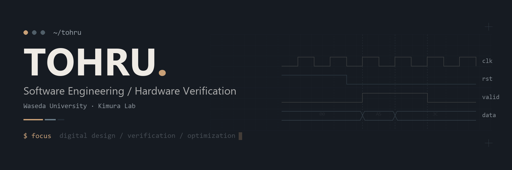

<picture>
  <source media="(prefers-reduced-motion: reduce) and (max-width: 600px)" srcset="./assets/hero-mobile.png">
  <source media="(prefers-reduced-motion: reduce)" srcset="./assets/hero.png">
  <source media="(max-width: 600px)" srcset="./assets/hero-mobile.gif">
  
</picture>

# Hi, I'm Tohru.

I'm pursuing a master's degree at **Waseda University**'s Graduate School of Information, Production and Systems, following my studies in Software Engineering at **Xiamen University**.

My work spans Linux systems, backend engineering, and applied AI, with a focus on software reliability, rigorous testing, and reproducible evaluation. At Kimura Lab, I'm exploring LLM-assisted hardware verification.

**Connect:** [Email](mailto:suyanyu.cs@gmail.com) · [University email](mailto:yanyu.su@toki.waseda.jp) · [LinkedIn](https://www.linkedin.com/in/tohru-watanabe) · [DEV Community](https://dev.to/tohrusu) · [ORCID](https://orcid.org/0009-0002-5960-6106)

## Current focus

<picture>
  <source media="(prefers-reduced-motion: reduce)" srcset="./assets/prompt.svg">
  
</picture> <strong>Currently</strong>

My current research explores how RTL static analysis and large language models can support the generation of SystemVerilog Assertions (SVA) from structural information and independent design specifications.

I'm investigating how to evaluate generated assertions beyond syntactic correctness, with an emphasis on specification consistency and defect detection.

Alongside my research, I continue to work on Linux systems, developer tooling, and open-source software, emphasizing correctness, regression testing, and reproducibility.

## Experience

- **Rakuten Group · Software Engineering Intern** — Built search features and interfaces using Flask and React/TypeScript.
- **DENSO · Automotive SoC Intern** — Investigated system wake-up latency and performance using C.
- **TokiTech · Web Developer** — Developed web applications with Spring Boot, Vue.js, and relational databases.
- **BitMeta Technology (China) · Frontend Development Intern** — Contributed to website development and maintenance.
- **ADK Holdings · Data Science Camp** — Analyzed consumer data and developed a retail marketing strategy.

## Featured projects

- **[Linux Wake-up Latency Benchmark](https://github.com/TohruSu/linux-wakeup-latency-benchmark)** · C/POSIX, Python — Measure Linux scheduling latency with reproducible benchmarks.
- **[RepoPort](https://github.com/TohruSu/RepoPort)** · Python, Git — Detect filename portability issues across operating systems.
- **[RoomShelf](https://github.com/TohruSu/roomshelf-catalog-explorer)** · React, Flask, SQLite — Full-stack furniture catalog with search, comparison, and favorites.
- **[Jetson Multimodal Emergency Detection](https://github.com/TohruSu/jetson-multimodal-emergency-detection)** · Python, Jetson Nano — Combine pose, speech, and depth cues for emergency alerts.
- **[Autonomous Tractor Navigation](https://github.com/TohruSu/autonomous-tractor-navigation-sim)** · C#, .NET — Simulate and compare autonomous path-tracking controllers.
- **[Retail Customer Segmentation](https://github.com/TohruSu/retail-customer-segmentation)** · Python, scikit-learn — Analyze customer segments and develop a retail strategy.

More projects (5)

- **[PyPathDoctor](https://github.com/TohruSu/PyPathDoctor)** · PowerShell — Diagnose Python command resolution and PATH precedence on Windows.
- **[AdaptiveQueue](https://github.com/TohruSu/adaptivequeue)** · Python, Q-Learning — Evaluate adaptive job scheduling against fixed policies.
- **[RunMatrix](https://github.com/TohruSu/RunMatrix)** · React, TypeScript — Compare JUnit test reports with an interactive status matrix.
- **[PathReplay](https://github.com/TohruSu/PathReplay)** · React, TypeScript — Visualize and replay 2D trajectories from CSV files.
- **[CuePair](https://github.com/TohruSu/CuePair)** · React, TypeScript — Compare subtitle timelines and identify timing differences.

## Open-source contributions

- **pyinfra** · [#2107](https://github.com/pyinfra-dev/pyinfra/pull/2107) — Fix APT package detection when another package provides the requested name.
- **Commitizen** · [#2128](https://github.com/commitizen-tools/commitizen/pull/2128) — Respect Git's `core.eol` setting across version providers.
- **Pode** · [#1827](https://github.com/Badgerati/Pode/pull/1827) — Fix HTTP chunked request parsing when the body arrives after the headers.
- **diff_cover** · [#658](https://github.com/Bachmann1234/diff_cover/pull/658) — Fix changed-line numbering when Git marks a missing final newline.
- **cog** · [#107](https://github.com/nedbat/cog/pull/107) — Fix creation of single-level output directories when using `-o`.
- **flake8-pyi** · [#561](https://github.com/PyCQA/flake8-pyi/pull/561) — Detect redundant negative integer literals in unions.
- **toml-sort** · [#110](https://github.com/pappasam/toml-sort/pull/110) — Ensure case-sensitive TOML override matching across platforms.
- **pyjson5** · [#167](https://github.com/dpranke/pyjson5/pull/167) — Fix empty `-c` CLI input handling.
- **pytest-order** · [#277](https://github.com/pytest-dev/pytest-order/pull/277) — Preserve ordering markers across repeated test collection.
- **setuptools-git-versioning** · [#169](https://github.com/dolfinus/setuptools-git-versioning/pull/169), [#168](https://github.com/dolfinus/setuptools-git-versioning/pull/168) — Fix Windows timestamps and hyphenated Git tag parsing.

More contributions (7)

- **ConfigUpdater** · [#193](https://github.com/pyscaffold/configupdater/pull/193), [#188](https://github.com/pyscaffold/configupdater/pull/188) — Correct missing-section errors and detached-block handling.
- **argcomplete** · [#579](https://github.com/kislyuk/argcomplete/pull/579) — Preserve tilde-prefixed directory completions.
- **dunamai** · [#122](https://github.com/mtkennerly/dunamai/pull/122), [#120](https://github.com/mtkennerly/dunamai/pull/120) — Fix Git archive metadata discovery and tag parsing.
- **flake8-bugbear** · [#619](https://github.com/PyCQA/flake8-bugbear/pull/619) — Improve exception-initializer analysis.
- **docformatter** · [#411](https://github.com/PyCQA/docformatter/pull/411) — Correct INI list-option parsing.
- **Streams-API-Practices** · [#29](https://github.com/ZahidFKhan/Streams-API-Practices/pull/29) — Fix Windows-incompatible filenames and documentation links.
- **Archy** · [#576](https://github.com/hslee16/Archy/pull/576) — Isolate Git signing settings in tests.

## Tools I use

###  Languages

**Most often:** Python · Java · JavaScript / TypeScript  
**Also:** C / C++ · C#

###  Web development

Spring Boot · Flask · React · Vue.js  
MySQL · SQLite

###  Systems and tooling

Linux/POSIX · PowerShell · Git · GitHub Actions  
Performance measurement · Automated testing · Sanitizers

###  Other interests

Computer vision · Depth estimation · Multimodal sensing  
Reinforcement learning · Path-tracking simulation

## Outside of code

I play the piano, enjoy badminton, and occasionally lose track of time editing music videos.

I'm fond of Haruki Murakami's novels and the films of Christopher Nolan and Quentin Tarantino.

Thanks for stopping by! If anything catches your interest, feel free to explore my projects.
